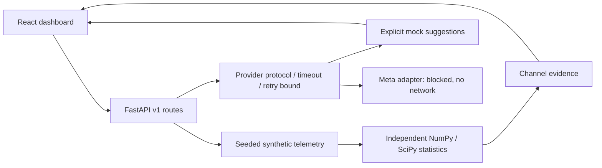
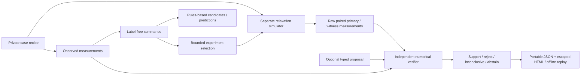

# Architecture

The current candidate adds the [industrial workstation](docs/industrial/ARCHITECTURE.md) to the existing modular monolith: coupled simulation, Three.js/2D machine inspection, bounded playback, existing numerical-verifier integration and a separately versioned report/replay format. Earlier versioned APIs and library behavior remain preserved. The milestone sections below document the architecture's evolution; current behavior and limits are in `docs/industrial/`.

FORGE is a modular monolith: one FastAPI process performs simulation, statistics, and provider orchestration. A React application requests typed JSON over same-origin `/api/v1` through Vite during development. No distributed workers, database, GPU, or external inference is required.

## Boundaries

- `backend/forge/config.py`: validated environment settings, checked at application startup.
- `simulation.py`: deterministic scenario generation and measurement schema.
- `analysis.py`: pure numerical computation, no model/provider calls.
- `providers.py`: request/response schemas, async protocol, mock provider, disabled Meta adapter, bounded transient-error retries and timeouts.
- `main.py`: transport validation, structured errors with server-generated request IDs, JSON request metadata logging, orchestration.
- `frontend/src/App.tsx`: fetched investigation rendering, scenario state, SVG charts, evidence and hypothesis panels. No frontend-generated telemetry fallback.

The statistical evidence is computed independently of mock suggestions. This does not yet constitute a verified investigation loop: no experiments are selected or executed, and no conclusions are accepted by a verifier. The timeline records simulated acquisition milestones, not a durable audit trail. The scenario name itself reveals ground truth in this demonstration; future evaluation must conceal it from inference and separate prompts from evaluation labels.

API errors use `{error: {code, message, request_id}}`; validation errors do not echo payloads. API shapes are documented in generated OpenAPI. The simulation response includes explicit `simulated` and model provenance fields. Meta mode is a deliberate disabled state, not a connectivity assertion. Configuration is process-local and cached; restart after changes.

## Development and deployment

Use the existing checkout in an isolated cloud task. Local development requires two processes; dependency files and build outputs persist, live processes do not. CI runs locked backend and frontend installs, pytest, Vitest, and a TypeScript/Vite production build. Production hosting, authentication, persistence, request limits, and lifecycle monitoring remain future work. No public deployment is configured.

## Phase 1 additions

`forge/engine/contracts.py` defines versioned typed records and the finite experiment registry. `oracle.py` is the only private synthetic case/experiment boundary. `hypotheses.py` receives `BlindInput`, never an oracle or recipe. `investigation.py` controls explicit state transitions and passes raw evidence to `verifier.py`. The verifier independently computes telemetry quality, paired t-intervals, support/contradiction, proposal rejection, and abstention. It does not import hypothesis generation or the private oracle. `routes.py` exposes a bounded, locked, process-local store and stepwise APIs; the original Phase 0 routes remain unchanged.

`reporting.py` normalizes ephemeral session IDs to deterministic evidence-derived run IDs and serializes raw measurements, hypotheses, interventions, results, references, verification, limitations, and reproduction instructions. `forge.replay` recomputes evidence offline with no inference or network access. Digests detect consistency errors; they are not signatures or a sensor-authenticity guarantee.

`forge.evaluate` alone holds answer labels. It feeds only observations into the investigation boundary, and compares final findings/selection against hidden answers after completion. Its published output is evaluation evidence, not inference input. This module-level boundary is tested but is not a hostile-code sandbox.

The frontend adds `InvestigationWorkflow.tsx` beside the preserved Phase 0 telemetry and mock-suggestion panels. It starts only on user action, advances one backend stage at a time, displays uncertainty and provenance, and exports the backend report. Rules-based and mock/model statuses remain explicit. Process-local sessions, simulation assumptions, and the single-fault verifier limit current applicability; see the evaluation report.

The earlier Phase 0 scope description above is historical: Phase 1 now implements bounded synthetic experiments and export/replay, while physical verification, production hosting, persistence, and eligible Meta integration remain incomplete.

## Phase 2 extension

The versioned `forge.phase2` modules add a provider-independent bounded transport, typed model proposals, calibrated thermal/waveform ingestion, a private multi-fault oracle, and an independent multi-intervention verifier. `contracts.py` contains public trial records so the verifier does not import private recipes. V1 modules and contracts are retained. ASGI request-body limits apply before parsing. The new dashboard lab operates on its own labeled synthetic cases. Reports record `deterministic_rules_not_meta`, `test_transport`, or `meta_http_response`; text suggestions never determine verification. Full data-flow, API, budget, replay and threat limitations are in [PHASE2.md](docs/PHASE2.md).

## Phase 3 architecture

The `/api/v3` modular monolith adds SQLite durable versioned sessions, a sequential selector, independent verifier, provenance ledger and replay. SafetyMiddleware wraps API access with local/public/private modes; public mode only allows fixed synthetic workflows. FastAPI serves the compiled React `/demo`; the non-root single-worker Docker image packages both. The verifier imports public contracts/statistics, never the private oracle or inference adapter. See docs/PHASE3.md for interfaces, trust boundaries and limits.

## Phase4 submission boundary

Submission tools are standalone trusted-owner CLIs, separate from HTTP routes. The public image uses a fail-closed launcher and exact Host/route allowlists. Only the approved owner smoke may instantiate an active provider after all gates; public sessions never do. See docs/PHASE4.md.

## Redesign and guarded multimodal input

The React application shell uses local state for six real investigation views and preserves versioned backend actions/exports. The event transport defaults to the confirmed -1026 ID, supports protected BASETEN_API_KEY with strict provider/model restriction, total deadlines, optional reported usage and a separately opt-in calibrated thermal PNG input. Visual source/PNG hashes are independently replayed; no raw waveform-to-audio transform is implemented. A private owner smoke receipt gates tested UI access; it is administrative evidence, not signed authentication. Public mode stays credential-free and hard-disabled for inference.
