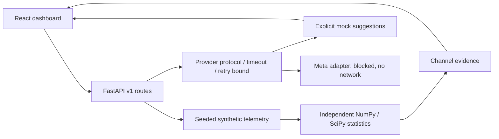

# Architecture

FORGE is a modular monolith: one FastAPI process performs simulation, statistics, and provider orchestration. A React application requests typed JSON over same-origin `/api/v1` through Vite during development. No distributed workers, database, GPU, or external inference is required.

## Boundaries

- `backend/forge/config.py`: validated environment settings, checked at application startup.
- `simulation.py`: deterministic scenario generation and measurement schema.
- `analysis.py`: pure numerical computation, no model/provider calls.
- `providers.py`: request/response schemas, async protocol, mock provider, disabled Meta adapter, bounded transient-error retries and timeouts.
- `main.py`: transport validation, structured errors with server-generated request IDs, JSON request metadata logging, orchestration.
- `frontend/src/App.tsx`: fetched investigation rendering, scenario state, SVG charts, evidence and hypothesis panels. No frontend-generated telemetry fallback.

The statistical evidence is computed independently of mock suggestions. This does not yet constitute a verified investigation loop: no experiments are selected or executed, and no conclusions are accepted by a verifier. The timeline records simulated acquisition milestones, not a durable audit trail. The scenario name itself reveals ground truth in this demonstration; future evaluation must conceal it from inference and separate prompts from evaluation labels.

API errors use `{error: {code, message, request_id}}`; validation errors do not echo payloads. API shapes are documented in generated OpenAPI. The simulation response includes explicit `simulated` and model provenance fields. Meta mode is a deliberate disabled state, not a connectivity assertion. Configuration is process-local and cached; restart after changes.

## Development and deployment

Use the existing checkout in an isolated cloud task. Local development requires two processes; dependency files and build outputs persist, live processes do not. CI runs locked backend and frontend installs, pytest, Vitest, and a TypeScript/Vite production build. Production hosting, authentication, persistence, request limits, and lifecycle monitoring remain future work. No public deployment is configured.
