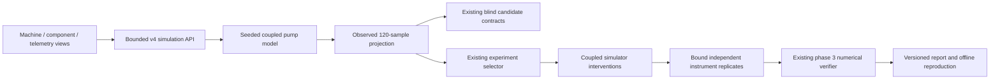

# Industrial workstation architecture

Branch `feature/forge-industrial-workstation`, based on exact `bf500f04ca865568cb28fb73f83ccc7a197aa360`. No production mutation, merge or historical rewrite is part of this work.

The existing modular monolith is preserved. `/demo` opens the machine workspace; **Investigation library** opens the established six-stage product at `/demo?view=investigations`. The query is application view state, not tracking. Existing v1/v2/v3 APIs and portable reports remain available under their existing access boundaries.

`forge.industrial.model` owns the deterministic model/catalog. `investigation` adapts observations/trials to the existing selector/verifier, then seals a new report format. `telemetry` defines a read-only import/adapter boundary. `routes` exposes only three bounded operations and a catalog. Frontend `industrial` modules own playback, rendering, local imports and inspection; no physics is driven by animation time.

Public simulation is stateless and bounded. Existing SQLite investigations retain their own version/lease/session limits. A browser recording/report is not durable unless exported. Switching views unmounts playback and disposes graphics resources. No new microservices, message brokers, databases, GPU servers or external runtime assets were introduced.
