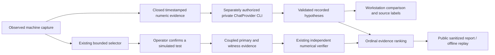

# Model integration architecture

The existing FastAPI/React modular monolith, coupled simulator, finite experiment policy, numerical verifier, SQLite library and restricted Docker launcher remain intact. Existing report formats are unchanged.

`forge.industrial.meta.prepare` derives evidence from the initial observed capture. It supplies `BlindInput` and a closed numerical feature object to the existing `ChatProvider.infer`. No scenario/seed, latent state, future samples, experiment witnesses, verification outcomes, arbitrary descriptions or filenames enter the actual serialized request. Context IDs come from the catalog; source labels such as SIMULATED_FAULT are not supplied. Fourteen sampled observation rows accompany the 120-sample numerical summary and acquisition-window timestamps. Only motor temperature, vibration and discharge pressure are projected into the existing verified channel contract. Other associated sensor IDs are context, not additional causal evidence.

The model uses the existing strict `ModelOutput`/`ModelHypothesis` contract. `evidence_channels` explicitly names the closed channel references; application-generated reference hashes bind them to the captured dataset. At least two distinct candidates are required. Each candidate must reference its registered channel (normal uses none). Unknown IDs, extra schema/tool fields, inconsistent references and screened URL/code/equipment-control narrative are rejected. No probability field is invented. Narratives are never interpreted as commands, regardless of the lexical screen.

`meta_cli` exclusively owns eventual network execution. It reuses the exact Baseten adapter, model identity checks, deadlines, zero retries and request/token reservations. The initial capture must have zero trials. A genuine smoke receipt, separate workstation authorization, account prerequisites and provider-limit confirmation are required before one request. All current execution uses an injected local transport. The public receipt projection whitelists only source/model identity, input/output hashes and structured hypotheses; usage, HTTP diagnostics and receipt timestamps remain private.

New public HTTP operations are GET `/api/v5/model-status` and POST `/api/v5/prepare`, `/api/v5/replay`, `/api/v5/advance`, `/api/v5/report.html`. None instantiates a provider. They inherit the existing host/body/rate/concurrency/CSP controls. `/api/v5/infer` does not exist and is forbidden publicly. Model status describes this HTTP application's unavailable live path, not the owner's global account configuration.

`forge-industrial-model-report-1` extends the coupled investigation artifact with recorded proposals and the exact permitted evidence. Its numerical decision/trials/plan are regenerated by the original simulator and verifier. Proposed causes affect the displayed ordinal comparison, never experiment selection or numerical support. Each advance confirms one next policy test, reuses the original proposal and makes no further inference request. Component selection cannot rewrite capture provenance.

The existing industrial replay CLI dispatches by artifact version and compares complete canonical digests. New reports reproduce recorded proposals and numerical evidence, not model sampling or source authenticity. Source/model fields are explicitly **unattested claims** on import; a recomputed hash is not a provider signature. The UI never sets verified genuine access from imported data. Old JSON/HTML exports and fixed genuine six-case evaluation remain preserved.
