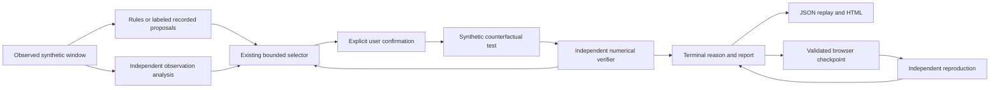

# Architecture and provenance boundaries

The original modular monolith remains: FastAPI/Pydantic input contracts, NumPy/SciPy statistical analysis, bounded synthetic experiment oracles, an independent sequential verifier, SQLite temporary library sessions, and React/TypeScript/Vite with locally bundled Three.js. There are no new services, queues, GPUs, paid assets or production dependencies.

The coupled pump projects only motor temperature, vibration and discharge pressure into the established verifier. Other instrumentation is explanatory simulation display, not additional verified evidence. The legacy library retains its own synthetic thermal/waveform/equipment metadata and independent channel contracts. Its reference 3D assembly is not a calibrated reconstruction; unavailable operating channels are not invented.

The inference adapter is provider-independent, private, timeout/budget bounded and financially gated. It receives observed-only input, not hidden recipe labels/seed/truth. Public operations cannot call it. Rules and offline transport fixtures are never relabeled as genuine Meta responses; a replayed claim cannot establish provider authenticity.

Phase 8 changes presentation and client reliability rather than numerical policy:

- Frontend progress and industrial HTML presentation derive terminal reason/counts from existing decision/trials/plan. No verifier threshold, selector ranking, trial seal or JSON schema changed. Presentation does not decide whether support exists.
- Instrument provenance is passed explicitly to the read-only strip, so counterfactual and imported values cannot be mislabeled observed. Empty/constant charts disclose missingness and scale padding; padding is not an uncertainty estimate.
- Resume is navigation only. New capture remains independently guarded, and terminal/invalid progress cannot authorize an extra test.
- A checkpoint file read is latched before asynchronous work. Callback identity and revision prevent attaching a delayed file to a changed/unmounted workspace. Reproduction still validates the full report before attachment.
- Library operation generations reject stale boot responses after another case starts. Synchronous action latches bound duplicate requests, reconnect aborts old work and reloads existing server state, and stale export responses cannot download the wrong case.
- Browser checkpoints retain one public record per family. Recipe/context/report data is validated and bounded; private keys/receipts and private-owner sessions are excluded. SQLite reconstruction allocates a fresh session identity and recomputes only submitted fixed-case history, not future tests or source authentication.

[The state matrix](STATE_TRANSITIONS.md), [stopping policy](STOPPING_POLICY.md) and [security review](SECURITY_REVIEW.md) describe exact transitions and limits. Original historical evidence and Git timestamps remain unchanged. Local production-image success does not certify the current Render artifact or actual industrial equipment.
